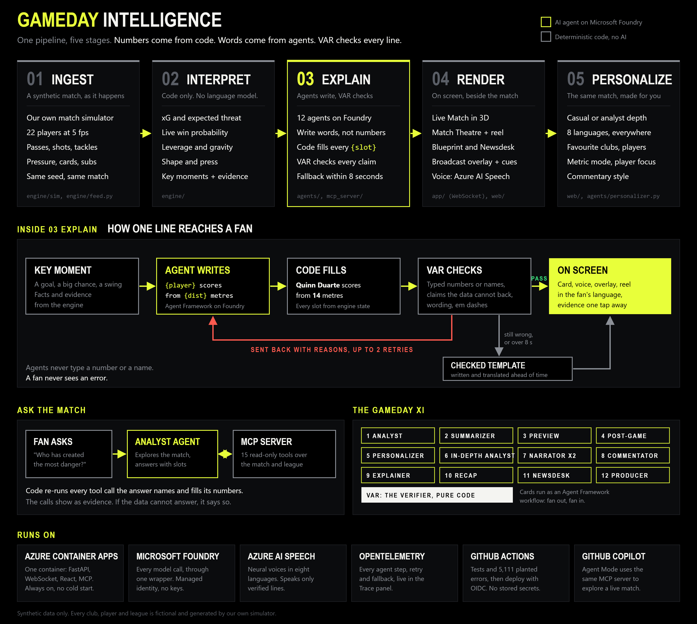
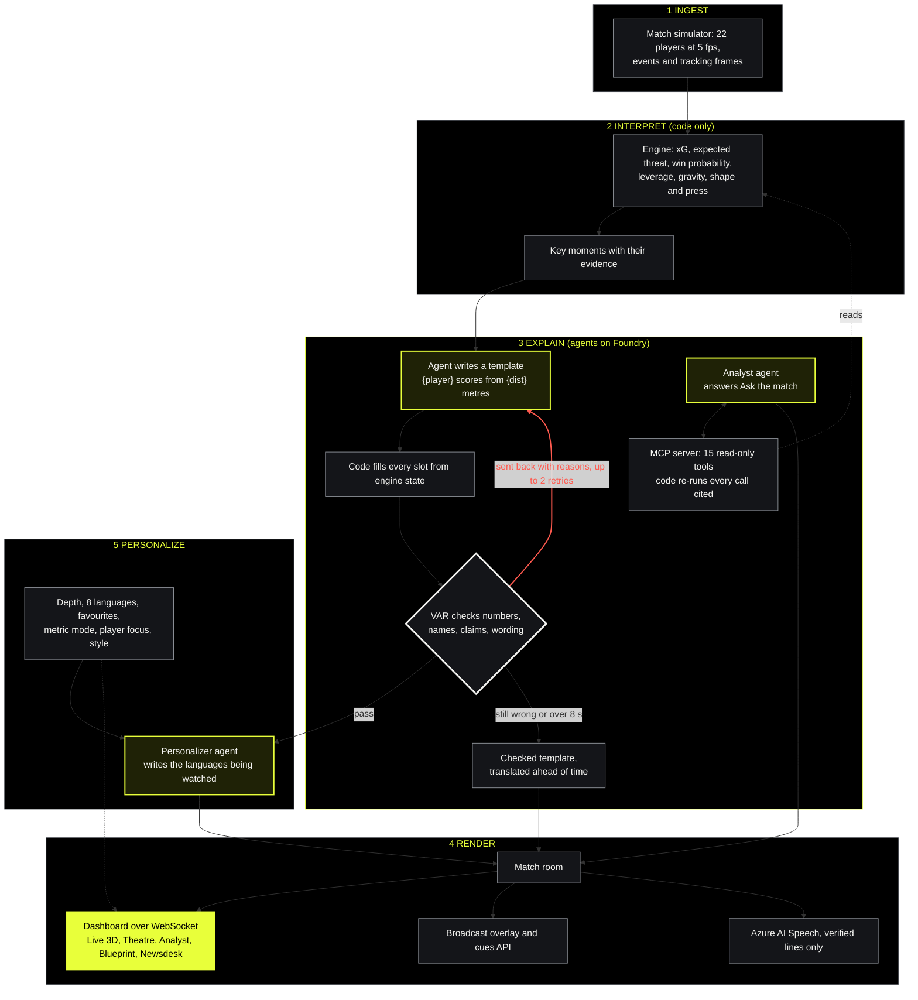
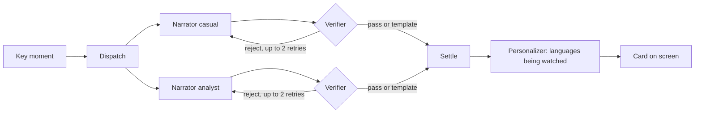

# Gameday Intelligence

Live, verified, personalized football match intelligence. Built for the Microsoft x Premier League "Inside the Game" hackathon.

**Watch the demo (1:57):** https://youtu.be/vox_YWON0Yc

**Try it:** https://gameday-intelligence.orangecliff-ca1053f4.eastus2.azurecontainerapps.io (no sign-in; a match is always live). Start on Home by clicking the Gameday Intelligence logo. **Judges:** [JUDGING.md](JUDGING.md) is a three-minute tour mapped to each judging criterion.

Gameday Intelligence turns a synthetic football match, with all 22 players tracked, into a live companion every fan can follow: key moment cards, commentary with a voice, a 3D pitch, a narrated highlights reel, match reports, and answers to any question about the match. It works in eight languages, at casual or analyst depth, around your favourite clubs and players.

Its core rule: **every number on screen comes from deterministic code.** Twelve AI agents on Microsoft Foundry write the words around those numbers as templates with slots like `{xg}`, code fills every slot from the match engine, and VAR, our Verifier, checks every claim before a fan sees it. If a model is slow or wrong, a checked template takes over within 8 seconds. A fan never sees an error.

All clubs, players and matches are fictional and generated by our own simulator.

## Architecture, end to end



Source: [docs/architecture.svg](docs/architecture.svg).

### The same flow, step by step

Yellow boxes are AI agents on Microsoft Foundry. Grey boxes are deterministic code. Red is the path a rejected line takes.



It runs as one always-on container on **Azure Container Apps**, calls **Microsoft Foundry** with a managed identity (no keys), traces every agent step with **OpenTelemetry** into the Trace panel, and deploys from **GitHub Actions** with OIDC after the tests and evals pass.

The challenge asks for one pipeline with five stages. Each maps to code:

| Stage | What happens | Where |
|---|---|---|
| 1. Ingest | Our simulator plays a match tick by tick: events (passes, shots, tackles, pressure, cards, subs) and a tracking frame of all 22 players at 5 frames a second. The same seed always plays the same match. | `engine/sim/`, `engine/feed.py` |
| 2. Interpret | Deterministic models turn the stream into xG, expected threat, live win probability, leverage, gravity, marking, shape and press, and emit key moments with their evidence. No language model is allowed here; a test enforces it. | `engine/` |
| 3. Explain | Agents on Microsoft Foundry, built with Microsoft Agent Framework, write templates over the evidence. Code fills the slots, VAR checks them, rejections go back with reasons. The Analyst answers questions through our MCP server. | `agents/`, `mcp_server/` |
| 4. Render | Each match runs in a room that streams frames, stats and cards over WebSocket to the React dashboard, the 1920x1080 broadcast overlay and a timed cues API. Azure AI Speech reads verified lines aloud. | `app/`, `web/` |
| 5. Personalize | Depth, language, favourite clubs and players, a metric to follow, player focus and commentary style. The same verified facts, two genuinely different experiences. | `web/`, `agents/personalizer.py` |

## The Gameday XI

Twelve agents, each solving one problem a fan has, plus VAR. Home shows them as a team on a pitch; press Kick off to watch them work.

| No. | Agent | The fan's problem it solves |
|---|---|---|
| 1 | Analyst | Made-up stats. Answers through 15 MCP tools; code re-runs every call it cites. |
| 2 | Summarizer | Arrived late, totally lost. Catch me up, in one verified paragraph. |
| 3 | Preview | No idea what is at stake. The story before kickoff. |
| 4 | Post-game | Final whistle, no takeaway. What decided it, and what each club takes into the next match. |
| 5 | Personalizer | Not in my language. Every card, story and answer in eight languages. |
| 6 | In-depth Analyst | Why is this even happening? A tactical read every fifteen minutes. |
| 7 | Narrator x2 | Score only, no story. A casual and an analyst card for every key moment, in parallel. |
| 8 | Commentator | Dead air. Commentary in Classic, Hype, Stats or Tactician style, with a neural voice. |
| 9 | Explainer | Saw the goal, did not get it. Explain this moment, beat by beat, in 3D. |
| 10 | Recap | Where is the match report? Written at full time on the Blueprint. |
| 11 | Newsdesk | What happened elsewhere? A report for every fixture. |
| 12 | Producer | No time to watch it all. A narrated highlights reel. |
| VAR | Verifier | Can I trust it? Pure code. Checks every line from every agent. |

## Run it

Requires Python 3.12.

```bash
python -m venv .venv
.venv/Scripts/activate        # Windows. On macOS or Linux: source .venv/bin/activate
pip install -e ".[dev]"
pytest
```

Run the dashboard (Node 20 or later for the web build):

```bash
cd web && npm ci && npm run build && cd ..
uvicorn app.main:app --port 8000
```

Then open http://localhost:8000. Add `?t=55` to start your own private replay at minute 55. While developing the web app, run `npm run dev` in `web/` and open http://localhost:5173 instead.

Or build the single container that Azure Container Apps runs:

```bash
docker build -t gameday-intelligence .
```

Watch a simulated match in the terminal, with live stats every minute and key moments as they happen:

```bash
python -m engine.cli --home KR --away AV --seed 7 --scenario data/scenarios/demo.json
```

Refit the public models on a fresh simulated season and regenerate the reports:

```bash
python -m engine.calibrate
```

## How data flows in

```
Feed (engine/feed.py)  ->  Live stats engine  ->  Match room  ->  WebSocket  ->  Dashboard
 simulator today            interpret, explain     cards, clips     frames, stats,
 recorded replay            key moments            history          cards, analyst
 provider adapter later
```

Everything downstream reads a match through a `Feed`, one tick at a time: the events of that tick, then the tracking frame. Today the feed is our simulator, because the hackathon requires synthetic data. A recorded feed replays any match exactly (`tests/test_feed.py` proves the stats come out identical). For a real league only the feed changes: an adapter that turns a data provider's live feed into the same `MatchEvent` and `TrackingFrame` contracts.

Agents sit on the room as stories over facts: code picks the facts (and, for the Highlights reel, the clips and their order), an agent writes templates, the Verifier checks them, and code fills every slot. The Producer chains the Explainer's verified clip stories into one reel between its own verified intro and outro.

## The engine

Everything a fan sees starts here, and none of it calls a language model.

- **Simulator** (`engine/sim/`). A fictional ten-club league. All 22 players move at 5 frames per second toward a formation shaped by the ball, the team's block (high press, mid block, low block), off-ball runs, fatigue and an offside line. The ball carrier shoots, passes, carries or holds. Outcomes are sampled from hidden team strengths and player traits, so the public models have to recover the truth from data. Scenario scripts inject incidents such as a red card at a set minute.
- **Metrics** (`engine/metrics.py`, `engine/xt.py`). Expected goals, pass difficulty, expected threat on a 16 x 12 grid fitted by value iteration, and distance, high-speed running, sprints, top speed, ball speed and shot speed, all measured from tracking frames.
- **Win probability** (`engine/winprob.py`). A live model that blends pre-match ratings with observed xG, then adjusts the scoring rate for the game state: a man up or down, winning or losing, and the last 15 minutes. Those effects are learned from minute-by-minute xG, not assumed, and goals still to come follow a Negative Binomial when the data shows more spread than Poisson. Ratings are fitted on previous simulated seasons, never read from the hidden truth.
- **Leverage** (`engine/leverage.py`). Inspired by NBA Inside the Game. Each action is compared with its opposite outcome, and the credit is split into shot making, creation, defending and turnovers. 1.0 leverage is 10 points of win value.
- **Shape and press** (`engine/shape.py`, `engine/press.py`). Low block and high press detection from tracking, and press resistance: how often a player keeps the ball when pressed.
- **Gravity, marking and spells** (`engine/gravity.py`, `engine/matchups.py`, `engine/spells.py`). Gravity, adapted from the NBA's, is the defenders a player pulls close beyond the league average for the same spot and role, from every tracking frame (+100 is one extra defender), split on and off the ball and by final third and build-up. The league average is fitted on simulated tracked matches. Marking assigns each attacker's nearest defender every frame and charges shots, xG, goals and passes received to that marker. Spells find each team's most dominant 10 minutes by threat.
- **Live stats** (`engine/live.py`). Consumes the stream and emits key moments for the agents: goals, red cards, big chances, low xG goals, leverage swings, top speeds, control flips and shape changes.

### How realistic is the simulator?

From 360 simulated matches (four full seasons); physical metrics from 12 matches with full tracking. Full report: [docs/realism.md](docs/realism.md).

| Per team per match | Simulated | Real football |
|---|---|---|
| Shots | 11.2 | 10 to 14 |
| Passes | 481 | 400 to 500 |
| Pass completion | 84.9% | 80 to 85% |
| Goals per match (both teams) | 2.7 | 2.5 to 3.0 |
| xG per shot | 0.12 | 0.09 to 0.13 |
| Fouls | 10.7 | 9 to 13 |
| Cards | 1.7 | 1.5 to 2.5 |
| Distance per outfield player | 10.9 km | 9.5 to 11.5 km |
| Top speed in a match | 33.3 km/h | 31 to 36 km/h |

### How accurate are the models?

Fitted on four simulated seasons (360 matches) and scored on a fifth season they never saw (90 matches). Full report: [docs/validation.md](docs/validation.md).

| Check on held-out data | Result |
|---|---|
| xG, refitted by regression | 240 goals against 246 expected (the hand-set first version expected 205); every band within a few points |
| Team ratings against the hidden strengths | Correlation 0.65 attack, 0.69 defence |
| Win probability at kickoff (RPS, the standard score for home, draw, away; lower is better) | 0.171 against 0.240 for a league-average baseline: 29% better |
| Win probability at half time (RPS) | 0.130 against 0.138: 5% better |
| Game-state effects, learned | Losing teams create 1.09x the xG, winning teams 0.95x, a man down 0.78x per player. Lasso found 1.08x and 0.94x for losing and winning on its own simulator |
| Shape detection against the block each team really played | 86% agreement; low block 92% precision and 73% recall, high press 90% and 72% |

Learning the game-state effects instead of hand-setting them improves the half-time forecast by 1%; most of the forecast's skill comes from the fitted ratings.

xG includes nearest-defender distance, the NBA's "defender contest". In our simulator it adds little beyond pressure, because the simulated world's shooting physics already uses pressure; on real tracking data it would carry more.

Our validation also caught a flaw in our own simulator: an early version let one hidden setting (pressing) decide almost every match, so fitted ratings did not track the clubs' real quality. Controlled experiments found it, and the fix is why the numbers above line up.

## The dashboard

- **Home.** Click the Gameday Intelligence logo. The whole product as a launch page, one idea per screen: the live score, the headline numbers, a live demo of agent writes, code fills, VAR checks, the Gameday XI on a pitch with Kick off, every feature, and the eval results.
- **Personal.** Pick one of eight languages (English, Español, Français, Português, Deutsch, Italiano, हिन्दी, 日本語) and the whole product follows: interface, cards, stories, Explain this moment, the reel and the voice. Pick several favourite clubs and players, and a single metric to follow (top speed, distance, xG or leverage). Your cards are marked and can be filtered, your players are always tagged on the pitch with your metric, and a live board ranks everyone by it. Preferences stay in your browser.
- **Live Match.** All 22 players on a 2D pitch at broadcast speed, gliding smoothly between tracking frames at any playback speed. Players are kit tokens with a heading tick, a sprint streak and a ring for the player on the ball; the ball is a real football that spins as it travels and lifts off its shadow when it is in the air. Passes draw as lines in the team's colour, shots streak to goal, won tackles and interceptions burst, cards pop up where they were shown, and a goal brings a broadcast GOAL banner and ripples the net. The score, clock, live win probability, momentum, control and chaos tick to each new value, and key moment cards slide in as they happen. Every card has a hero number, a casual and an analyst version, and opens the evidence and formula behind it. Player focus follows one player with live distance, speed and leverage.
- **3D pitch.** The `2D | 3D` switch on the Live pitch opens an interactive 3D view (three.js, loaded only when picked; it falls back to the 2D pitch if WebGL is missing or anything fails). Players in full kit with shirt numbers run, lean on the ball, lunge into tackles, and keepers dive at shots. A night stadium with stands, a crowd in both clubs' colours, boards for the fictional Meridian League and floodlights. The ball leaves a short trail; shots and long balls draw their real flight path, and a goal bulges the net and cuts to a camera behind it. Cameras: Broadcast, Behind goal, Tactical, Follow ball, Player cam, Eye line, and a Director that cuts between angles by itself. Layers draw team shape, open passing lanes from the player on the ball, and which side would reach each patch of grass first. Name tags sit over the focused and highlighted players; drag to orbit, scroll to zoom, click a player to focus. **Explain in 3D** on a goal or big chance card replays the shot's tracking clip with telestration: the build-up passes as arrows, the passer and shooter ringed, the shooter's view of goal shaded, the nearest defender marked, and captions filled by code from the engine's shot record (distance, angle, defender distance, xG, win probability).
- **Analyst.** Shot quality beeswarm by xG in the style of NBA Inside the Game, an xG race of cumulative chances with goals marked, a pass network built from tracking (average position in possession, linked by completed passes), a sortable player leverage table, press resistance, hardest goals scored, fastest players and a team shape timeline.
- **Shot replay and player pages.** Click any shot in the beeswarm, a goal card or a shot map. The Shot page replays the 12 seconds before the shot from tracking data, with all 22 players, the ball, the numbered passes of the move and a scoreboard strip, next to its difficulty (xG), distance, angle, nearest defender, pressure, shot speed, creator and what it was worth to the win probability. The Player page shows game averages in the spirit of the NBA player shot page: goals above expected, average xG of goals and of misses, average nearest defender at the shot, physical numbers, a heatmap from every tracking frame and every shot with its replay.
- **League.** `#/league` (the League tab) is the world around the live match: ten fictional clubs, each with an original crest, nickname, ground and playing style; the table, form, results and top scorers from a simulated season (last season in full plus eight matchdays, 130 matches from the same engine, cached in `data/season.json` by `python -m engine.season`); and matchday 9, five fixtures with a story each. **Watch live** starts any of them.
- **Scenario library.** `data/scenarios/` holds one story per matchday 9 fixture: ten men at Harbour Park, the Marsh derby comeback, a smash and grab upset, a ten-man fight-back and a 0-0 chess match. Goals cannot be scripted, so `python -m engine.scenarios` searches seeds until the match plays the story, and the tests replay every scenario to check it still does.
- **Match Blueprint.** `#/blueprint` (the Blueprint tab) tells the whole match on one page, after the NBA Inside the Game Blueprint: a match overview written from verified numbers, a highlight reel of tracking replays, top performers, a shot difficulty explorer where clicking any shot names the shooter and the nearest defender with its xG and details, a Gravity heatmap in the NBA's style with a player card, a marking spotlight and a leverage spotlight. It updates live and doubles as the full-time report.
- **Broadcast overlay.** `#/overlay` is a 1920x1080 graphics package on a transparent page, ready for OBS or a vision mixer: a score bug with a live win probability strip, a GOAL flash, and verified cue cards as lower thirds. `#/overlay?bg=pitch` previews it over the live pitch, and `&aud=analyst` switches the cue depth. The Overlay link in the header opens it.
- **Streaming.** `app/` runs each match live in a room and streams frames, stats, cards and analyst data over WebSocket. The main room is the shared broadcast; `?t=55` opens a private replay of the same match from minute 55. Timed, machine-readable overlay cues for a broadcast renderer are at `GET /api/rooms/{room}/cues`.
- **Cards that never wait.** Every card goes out at once from `agents/fallback.py`: templates that contain only words, with every number and name filled from the moment's evidence, and is swapped for the agent's verified text when it lands. A test fails if any template contains a digit. These are also every agent's fallback.

## The agents

Built with Microsoft Agent Framework on Microsoft Foundry, through one wrapper (`agents/llm.py`) that gives every model call an 8 second timeout, timing for the trace and a replay cache.

- **Narrator** (`agents/narrator.py`) turns a key moment into a card. It writes a template with slots like `{player}` and `{xg}` plus the claims it makes; it never types a number or a name.
- **Verifier** (`agents/verifier.py`) is deterministic code. It rejects typed numbers and names, unknown slots, details the evidence does not contain, declared claims that contradict the numbers, and wording that implies one ("equaliser" when the score is not level). Rejections go back to the Narrator with reasons, up to two retries; after that, or on a timeout, the card keeps its verified template.
- **Commentator** (`agents/commentator.py`) says each key moment in the style a fan picks: Classic (the Narrator's own line), Hype, Stats or Tactician. Each style is a template with slots and goes through the same Verifier, retries and fallback as the Narrator, so only the tone changes, never the facts. Lines are written on request, once per style and language, and shared by every viewer.
- **Voice** (`app/speech.py`) reads the commentary aloud with Azure AI Speech neural voices, a different voice per style and language, in all eight languages. It is keyless: Microsoft Entra ID through the same Foundry resource, with the Cognitive Services Speech User role. The API takes a moment id, never free text, so only verified lines are spoken. If Speech is slow or off, the browser's own voice reads the same line.
- **Personalizer** (`agents/personalizer.py`) writes every verified card, story and answer in Spanish, Hindi, French, Portuguese, German, Japanese and Italian, only for the languages fans are watching in right now (a language is written from the moment a fan picks it, and the latest cards catch up), so cost does not grow with the number of languages. The slots carry over untouched, so numbers and names stay correct in every language; a translation that drops, adds or alters a slot, or types a number or name, is refused.
- **Translations made ahead of time** (`agents/i18n.py`, `app/i18n_build.py`, `app/ui_strings.py`): every template line (what fans see when an agent is slow or fails), every word code puts in a slot ("low block", "a big chance") and all 400 interface strings were translated once on Foundry and checked with the same slot check, then committed. At run time they are a lookup, so a fan never falls back to English even when the model is down.
- **Recap** (`agents/recap.py`) writes the Match Blueprint's match report at full time, or on request, over the engine's facts, each a slot. Same checks as every card.
- **Preview** (`agents/preview.py`) writes the story before kickoff on the Preview tab: table positions, form, how the styles meet, the head to head and the pre-match forecast from the fitted team ratings (`engine/forecast.py`). Code picks the facts and the players to watch (`app/matchday.py`); the agent writes a headline and story over them as templates. Wording such as "unbeaten", "derby" or "favourites" passes only when the facts support it.
- **Post-game** (`agents/postgame.py`) fills "After the match" on the Blueprint. What decided it is code: the three key moments that moved the win probability most, each with its verified line. The agent writes what each club should watch next time, over the next fixture and its forecast, finishing against xG and the styles.
- **Producer** (`agents/producer.py`) makes the Highlights reel in the Match Theatre. Code picks and orders the clips (`app/producer.py`): every goal, then the best other big chances by xG plus the win probability riding on them, at most six, in match order. Each clip plays as a compact Explain this moment replay (the build-up runs through, the shot and the verdict hold while the Explainer's verified lines are read). The agent writes only the intro and outro, as templates over the match facts (score, xG, the biggest win probability swing). The same match checks as the Summarizer apply, plus a ban on cause and effect claims; up to two retries, then the template. The reel is cached and rewritten only when the status, score or clip list changes. `GET /api/rooms/{room}/reel` and `POST /api/rooms/{room}/reel/speech` (intro or outro, verified text only).
- **Analyst** (`agents/analyst.py`) answers "Ask the match" questions. It explores the match through our MCP server (Agent Framework's `MCPStreamableHTTPTool`), then answers with slots that each name a tool, its arguments and the field to read; code re-runs those calls and fills the answer, and shows them as evidence. If the data cannot answer, it says so.
- **In-depth Analyst** (`agents/deep.py`) writes an analyst read every fifteen minutes and soon after a goal or red card: the last fifteen minutes against the fifteen before (share of the threat, chances, shots), each team's defensive shape (block, line height, compactness, pressers) and the player with the most gravity, with a five-minute threat chart. It gets only the facts for that card, because in live runs the model pinned unrelated numbers on the wrong player when more were on offer.
- **Card desk workflow** (`agents/workflow.py`) is a Microsoft Agent Framework workflow: Dispatch fans each key moment out to two Narrator executors running in parallel (casual and analyst, each with the Verifier and its retries inside), Settle fans them back in, and the Personalizer writes the languages fans are watching right now.


- **Tracing** (`agents/tracing.py`): Agent Framework's OpenTelemetry spans for every workflow run, executor and model call (model, tokens in and out, duration) are collected in the app and shown under Trace, Workflow spans (`GET /api/spans`). Set `OTEL_EXPORTER_OTLP_ENDPOINT` to send them to any OTLP backend too. Prompts and replies are never recorded.
- **Card desk** (`agents/desk.py`) runs that loop. Cards go out instantly as templates and are swapped for the Narrator's verified text when it lands, so live play never waits.
- **Trace panel**: the Trace button shows every agent step live, with timings, rejections and fallbacks. `GET /api/rooms/{room}/trace` returns the same.
- **MCP server** (`mcp_server/`) at `/mcp`: fifteen read-only tools over the live match and the league (`get_match_state`, `get_player_live`, `compare_windows`, `get_league_table`, `get_head_to_head`, `get_fixture_forecast`, `verify_claims` and more) for the agents and for GitHub Copilot Agent Mode (`.vscode/mcp.json`).

Connect Foundry: `az login`, copy `.env.example` to `.env` and set `FOUNDRY_PROJECT_ENDPOINT` and `MODEL_STRONG`, then run `python -m agents.check_foundry`. Without it the app runs on verified templates and the trace says so.

## Agent evals

`python -m tests.agent_eval` (results on the Evals page, `#/evals`, linked from Home, and in `data/evals/report.json`):

- **Planted errors:** 5,111 of 5,111 caught, 557 of 557 clean lines passed. Real key moments, previews, reports and answers from the five scenario matches are broken on purpose (typed numbers and names, false claims, made-up details, broken translations, fake tools) across every agent. Runs in CI.
- **Live agents on Microsoft Foundry (gpt-4.1-mini):** 199 of 206 lines went live in the agent's own words (Narrator, Commentator in three styles, Personalizer in Spanish and Hindi); the other 7 kept their verified template. 0 numbers in any published line that a slot did not supply.
- **Ask the match:** 10 of 12 questions answered correctly against the same MCP tools on a paused match, 2 declined honestly, 0 wrong answers shown; 3 of 3 questions the data cannot answer were refused honestly.

The harness has found real bugs: an overclaiming fallback template, missing checks (pronouns, units after slots, "drawn"), a Verifier false reject on shape claims, Foundry rate limits under load (now queued and retried), and scenario matches that replayed differently live.

## Deployment

Live at https://gameday-intelligence.orangecliff-ca1053f4.eastus2.azurecontainerapps.io (MCP at `/mcp`).

- **Azure Container Apps** runs one always-on replica, so the live match never cold-starts.
- **Microsoft Foundry** serves the models. The app's system-assigned managed identity holds the Foundry User role, so there are no keys anywhere.
- **GitHub Actions** (`.github/workflows/build.yml`) on every push to `main`: run the tests and the dashboard build, build the image and publish it to GitHub Container Registry, then sign in to Azure with OIDC and roll the Container App onto that image and check it answers. Azure trusts only this repository's `main` branch, and the deploy identity can change only this one Container App. No secret is stored in GitHub; the four `AZURE_*` repository variables are plain IDs.

## Rules the code enforces

- `engine/` never imports a model or network SDK (`tests/test_engine_rules.py`).
- All randomness goes through `engine/rng.py`, so the same seed always gives the same match (`tests/test_determinism.py`).
- Agents write templates with slots like `{xg}`. A template whose slots do not match its values is rejected before it can reach a fan (`engine/models.py`).

## Layout

```
engine/      deterministic core: rng, data contracts, simulator, metrics
agents/      Foundry agents, prompts, verifier, fallbacks
mcp_server/  MCP tools that expose match state to agents
app/         FastAPI app, WebSocket, replay mode
web/         React dashboard
data/        scenario scripts, fitted models (xT grid, ratings), cached replays
docs/        SPEC.md, DESIGN.md, architecture.svg, realism and validation reports, video script
tests/       pytest
```

## License

MIT. See `LICENSE`.
